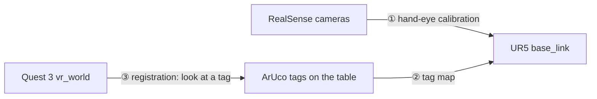

# UR5 + Meta Quest 3: One Shared Coordinate System (ROS 2 Humble)

This repo makes a **UR5 robot arm**, two **Intel RealSense cameras** and a **Meta Quest 3 headset** agree on where things are in the room. It's the base layer for a mixed-reality robot game. Once it's set up:

- the game knows where the real robot is, so virtual objects line up with it;
- your robot code gets the headset and controller positions in the robot's own coordinates;
- you can steer the arm's target by moving a controller, and check that it moves the way your hand does.

Everything also runs in **simulation in RViz**, with no robot or headset. That's the best place to start.

## Start here

| You want to… | Go to |
|---|---|
| See it working in 5 minutes, no hardware needed | [Install](#install-ubuntu-2204--ros-2-humble), then [Try it in simulation](#try-it-in-simulation) |
| Build a bare Quest app to test the headset calibration, no robot needed | [Headset calibration test app](docs/headset-test.md) |
| Set up the real robot, cameras and headset | [Set up the real system](#set-up-the-real-system) |
| Use the controllers in your robot code | [Use the headset in robot code](#use-the-headset-in-robot-code) |
| Build the Unity game | [Building the game](#building-the-game) and the [Unity developer guide](unity/README.md) |

## The idea in one minute

Every device measures positions in its own coordinate system, called a **frame**. The robot uses `base_link` (the centre of its base). The Quest uses its own world frame, which we call `vr_world`. The same cup has different coordinates in each frame, so we need the **transform** (a rotation plus a translation) between them.

Printed **ArUco tags** (square barcodes that a camera can locate precisely) link the frames together:



1. **Hand-eye calibration:** where each camera is relative to the robot. Done once.
2. **Tag map:** the calibrated cameras find the tags and save their positions in `base_link`. Done once, or whenever the tags move. No cameras? You can [measure a tag by hand](#no-robot-cameras-measure-the-tag-by-hand) instead.
3. **Registration:** the headset looks at a tag. That tag's position is now known in both frames, which gives `base_link → vr_world`. It takes a few seconds; do it every time the game starts.

ROS's transform library (**TF**) then chains these together, so any node can ask "where is the right controller, in `base_link`?"

> **Names:** in this repo, *hand-eye calibration* means camera ↔ robot, and *registration* means headset ↔ robot. People often call both "calibration".

## What's in the repo

Each ROS package does one job and talks to the others only through topics, services and TF, so you can swap any piece.

| Folder | What it does |
|---|---|
| `src/calib_target_detector`, `src/handeye_*` | ① Camera ↔ robot calibration, published to TF |
| `src/aruco_tag_mapper` | ② Finds the tags with both cameras and saves `tag_map.yaml` |
| `src/vr_tag_detector`, `src/vr_registration` | ③ Finds the tags in the Quest's camera images and solves `base_link → vr_world` |
| `src/vr_tracking` | Streams the headset and controllers into ROS. **This is what your robot code uses** |
| `src/vr_teleop` | Hold the grip button to move the arm's target with the controller; checks the arm moves the right way |
| `src/vr_sim` | A fake Quest and a simulated UR5, for testing everything in RViz |
| `src/yolo_detector`, `src/object_localization` | Finds a cup (or any COCO object) with YOLO + depth |
| `src/ur5_bringup` | Launch files, configs and RViz layouts |
| `src/ur5_common`, `src/*_interfaces` | Shared transform math, custom messages and services |
| `unity/RobotRegistration` | C# scripts for the Quest app ([Unity developer guide](unity/README.md)) |

## Install (Ubuntu 22.04 + ROS 2 Humble)

You need Ubuntu 22.04 with [ROS 2 Humble](https://docs.ros.org/en/humble/Installation/Ubuntu-Install-Debs.html) installed. Then:

```bash
git clone https://github.com/FelixW1020/UR5-arm.git ~/UR5-arm   # this repo is the colcon workspace
cd ~/UR5-arm
source /opt/ros/humble/setup.bash
sudo apt install ros-humble-ur ros-humble-realsense2-camera ros-humble-vision-msgs \
                 ros-humble-cv-bridge ros-humble-message-filters ros-humble-tf2-ros
git clone -b main-ros2 https://github.com/Unity-Technologies/ROS-TCP-Endpoint.git src/ros_tcp_endpoint
pip install -r requirements.txt                # ultralytics, OpenCV 4.x, numpy<2
sudo rosdep init; rosdep update                # first time only ("already initialized" is fine)
rosdep install --from-paths src --ignore-src -y
colcon build --symlink-install
```

**Every new terminal** needs these two lines before any `ros2` command. You can also add them to the end of `~/.bashrc` once:

```bash
source /opt/ros/humble/setup.bash
source ~/UR5-arm/install/setup.bash
```

Keep OpenCV below 5 and NumPy below 2 (`requirements.txt` pins both). OpenCV 5 dropped the hand-eye solvers, and Humble's `cv_bridge` needs NumPy 1.x.

## Try it in simulation

No robot, cameras or headset needed. After [Install](#install-ubuntu-2204--ros-2-humble), run **one** of these:

```bash
ros2 launch ur5_bringup vr_sim.launch.py controller_mode:=scripted  # hands-free demo
ros2 launch ur5_bringup vr_sim.launch.py                            # you drag the controller
```

What happens in RViz:

1. A fake Quest "looks" at three virtual tags and sends camera images, just like the real headset.
2. After ~4 s it registers itself. The log prints `Auto-registration succeeded`, and the estimated frame `vr_world` lands on the true one, `vr_world_truth`.
3. The simulated arm follows the controller:
   - **Scripted:** after 8 s the controller traces a 20 cm square with the grip held.
   - **Drag:** right-click the red *right controller* box, tick **Grip (drive the arm)**, then drag the box. Untick Grip to let go.

Two numbers worth checking. Run `ros2 topic echo <topic>` in a second terminal:

| Topic | Meaning | Typical sim value |
|---|---|---|
| `/quest_sim/registration_error_m`, `_deg` | How far the registration is from the truth | ~4 mm, ~0.05° |
| `/vr_alignment_monitor/direction_error_deg` | Angle between how your hand moved and how the arm moved | ~0.05° on slow, straight moves. Larger when you move fast, with spikes at sharp corners, because the arm lags behind your hand |

**Real headset, simulated arm:** `ros2 launch ur5_bringup vr_sim.launch.py quest:=real` lets the Quest app drive the simulated arm. It needs a tag map: from [Step 2](#step-2-map-the-tags), [measured by hand](#no-robot-cameras-measure-the-tag-by-hand), or any file passed as `tag_map_file:=<file>`.

## Set up the real system

Run these on the PC connected to the robot and cameras. You need each camera's serial number (`rs-enumerate-devices -s`), and the **External Control** URCap installed on the UR pendant.

### Step 1: Calibrate the cameras (once)

1. Print the calibration board (`ros2 run calib_target_detector generate_board --out board.png`) at 100% scale, glue it to something flat and rigid, measure one square, and set `square_length` in `src/ur5_bringup/config/calibration.yaml`.
2. Calibrate each camera:
   ```bash
   export WRIST_CAM_SERIAL=<SN> TABLE_CAM_SERIAL=<SN>
   scripts/handeye_calibrate.sh <UR_IP> wrist_cam    # board fixed on the table
   scripts/handeye_calibrate.sh <UR_IP> table_cam    # board clamped to the robot's flange
   ```
3. Freedrive the arm to a pose, let it stop, and press **Enter** to take a sample. Take 15–20 samples, and **rotate the wrist a lot** between them (±30° or more, about different axes). Sliding the arm around without rotating it can't be solved.
4. Press **s** to solve and save. A good result is off by a few mm and well under 1°.

Other console keys: `u` undo, `r` reset, `c` compute without saving, `?` status, `q` quit.

### Step 2: Map the tags

Do this once, and again whenever a tag moves.

1. Print tags: `ros2 run aruco_tag_mapper generate_tags --ids 0 1 2 3 4 5 --out-dir tags/`. Measure the printed black square and set `marker_length` in **both** the `aruco_tag_mapper` and `vr_tag_detector` sections of `src/ur5_bringup/config/vr.yaml`. If the two don't match, the headset refuses to register and tells you why.
2. Tape them flat around the table, spread out, where the cameras and the headset can see them.
3. Launch the robot, cameras and Quest connection:
   ```bash
   ros2 launch ur5_bringup vr.launch.py robot_ip:=<IP> wrist_cam_serial:=<SN> table_cam_serial:=<SN>
   ```
   Move the arm so the wrist camera also sweeps over the tags.
4. Save the map:
   ```bash
   ros2 service call /aruco_tag_mapper/save std_srvs/srv/Trigger
   ```
   This writes `~/.ros/handeye/tag_map.yaml`. It also reports how far apart the two cameras' estimates of each tag are. A few mm means your calibrations agree; centimetres means one of them is off.

#### No robot cameras? Measure the tag by hand

You can skip Step 1 and the cameras completely: measure where a tag is relative to the robot and write the tag map yourself.

1. **Find the robot's axes.** Start the robot without cameras: `ros2 launch ur5_bringup vr.launch.py robot_ip:=<IP> launch_cameras:=false`. In RViz, open the TF display's *Frames* list, untick *All Enabled* and tick only `base_link`. Its red arrow is +x and its green arrow is +y.
   - With all frames shown, `base` and `base_link_inertia` sit at the same spot pointing the **opposite** way, so it's easy to pick the wrong arrow.
   - Don't copy x and y from the teach pendant either: its Base coordinates are turned 180° from `base_link`.
2. **Place the tag.** Tape one tag flat on the surface the robot stands on, face up, with its **top edge** (the edge opposite the printed label) pointing along +y.
3. **Measure it.** Easiest: freedrive the arm until the flange is right above the tag centre, and read x and y from `ros2 run tf2_ros tf2_echo base_link tool0`. Or use a tape measure from the centre of the robot's base along the arrows (x and y can be negative).
4. **Write the map** to `~/.ros/handeye/tag_map.yaml`:
   ```yaml
   frame_id: base_link
   dictionary: DICT_4X4_50
   marker_length: 0.10          # the printed black square, in metres
   tags:
     0:
       position: {x: 0.50, y: 0.20, z: 0.0}           # tag centre in base_link
       orientation: {x: 0.0, y: 0.0, z: 0.0, w: 1.0}  # face up, top edge along +y
   ```
   If your printed square isn't exactly 10 cm, put your measurement here **and** in the `vr_tag_detector` section of `src/ur5_bringup/config/vr.yaml` (for the simulation: `vr_sim.yaml`). If the two differ, the headset refuses to register.

With one tag, the robot's heading comes only from how straight you taped it. 1° off turns the whole robot by 1° (about 2 cm at 1 m away), and nothing warns you. 2–3 tags spread across the table fix that, because their positions then set the heading. For a tag turned by an angle θ (counterclockwise, seen from above), use `orientation: {x: 0.0, y: 0.0, z: sin(θ/2), w: cos(θ/2)}`; for example, 90° gives `z: 0.7071, w: 0.7071`.

Don't call `/aruco_tag_mapper/save` afterwards, because it overwrites this file. Keep the `launch_cameras:=false` launch running and go on to Step 3.

### Step 3: Register the headset (every session)

Keep `vr.launch.py` running (from Step 2, or the `launch_cameras:=false` one if you measured by hand). It also starts the ROS-TCP-Endpoint (port 10000) that the Quest app connects to. Set up the Quest app first ([Unity developer guide](unity/README.md)).

1. In the headset, look at a mapped tag from about 0.5–1 m away and hold your head still for ~2 s.
2. Press **A** in the headset.

For testing, you can also register from the PC with `ros2 service call /vr_tag_detector/register vr_interfaces/srv/SolveRegistration "{save: true}"`. The app isn't told about it, though: the game's `onRegistered` doesn't fire, and after a recenter the app keeps sending poses as untracked.

One tag is enough. 2–4 tags spread over the table are more accurate (about 1 cm) and let the result check itself.

Register again at the start of every session, and whenever the virtual tag squares shown in the headset no longer sit on the printed tags. **Recentering the headset** (holding the Meta button) shifts the headset's world, so the registration stops fitting. The app notices this, stops sending poses and asks you to register again.

Other ways to register (touching the tags with the controller, or clamping a controller to the robot's flange) are in the [Unity developer guide](unity/README.md#other-ways-to-register).

### Step 4: Check the arm moves in the controller's direction

This tests your registration on the real robot without commanding it. With `vr.launch.py` running (without `teleop:=true`) and the headset registered:

```bash
ros2 run vr_teleop alignment_monitor --ros-args -p engaged_topic:="''" -p min_motion_m:=0.10 -p summary_every:=1
```

1. Hold the right controller firmly against the robot's flange.
2. Put the arm in freedrive and push it in straight **horizontal** 10–20 cm lines (forward/back, left/right) without twisting the wrist.
3. Every 10 cm of motion prints one angle (also on `/vr_alignment_monitor/direction_error_deg`). This is your registration's heading error. A few degrees or less is good. If it's larger, register again with more tags.

Don't judge by up/down lines: they read about 0° even when the heading is off.

### Extra: find a cup

```bash
ros2 launch ur5_bringup cup_detection.launch.py robot_ip:=<IP> wrist_cam_serial:=<SN> table_cam_serial:=<SN>
```

The cup's pose streams on `/object_localization/target_pose` in `base_link`. Use `target_class:=bottle` (or any COCO class) to find something else.

## Use the headset in robot code

Once registered, `quest_bridge` publishes everything in the robot's frame using standard ROS messages:

| What | Type |
|---|---|
| TF frames `quest_head`, `quest_left_controller`, `quest_right_controller` | TF (x axis = where you look / point) |
| `/quest/head/pose`, `/quest/left_controller/pose`, `/quest/right_controller/pose` | `geometry_msgs/PoseStamped` in `base_link` |
| `/quest/left_controller/joy`, `/quest/right_controller/joy` | `sensor_msgs/Joy`: `axes = [stick x, stick y, trigger, grip]`, `buttons = [A/X, B/Y, stick press, menu]` |
| `/vr_teleop/target_pose` (with `teleop:=true`) | `geometry_msgs/PoseStamped`: where the tool should go while you hold the grip |

Once the tags are mapped, you don't need the cameras any more. If your own launch already starts the UR driver, start only the headset side (Quest connection, registration, `quest_bridge`):

```bash
ros2 launch ur5_bringup vr.launch.py launch_robot:=false launch_cameras:=false rviz:=false
```

When a controller loses tracking, its `/quest/*/pose` topic simply stops. TF instead keeps returning the **last** pose, so always check how old a TF pose is. A minimal node that prints the right controller's position:

```python
import rclpy
from rclpy.duration import Duration
from rclpy.node import Node
from rclpy.time import Time
from tf2_ros import Buffer, TransformException, TransformListener

rclpy.init()
node = Node('controller_reader')
tf_buffer = Buffer()
tf_listener = TransformListener(tf_buffer, node)

def tick():
    try:
        tf = tf_buffer.lookup_transform('base_link', 'quest_right_controller', Time())
    except TransformException:
        return                          # not registered yet, or never seen
    age = node.get_clock().now() - Time.from_msg(tf.header.stamp)
    if age > Duration(seconds=0.2):
        node.get_logger().info('right controller not tracked')
        return                          # tracking lost: this is an old pose
    p = tf.transform.translation
    node.get_logger().info(f'right controller at ({p.x:.3f}, {p.y:.3f}, {p.z:.3f}) m')

node.create_timer(0.1, tick)
rclpy.spin(node)
```

> **Safety:** nothing on the VR side moves the real robot. `/vr_teleop/target_pose` is only a target. Your controller (or MoveIt Servo) must limit speed, because the target can jump. The only part of this repo that moves the arm is the optional pose replay during hand-eye calibration (`use_motion:=true`).

## Building the game

The game is a Unity app on the Quest. The [Unity developer guide](unity/README.md) walks through it. In short:

- Copy `unity/RobotRegistration/` into the Unity project and add a few objects to the scene.
- The game starts with a short calibration: the player looks at a tag and presses A. `RobotWorldFrame.onRegistered` tells the game when to start.
- Anything parented under a `RobotBase` object lines up with the real robot once calibrated.
- You can build the game first and add calibration later. Follow the guide's [five rules](unity/README.md#build-the-game-now-add-calibration-later) from the start (for example, no teleport locomotion) and it's a drop-in job.
- No robot around? Write a [hand-measured tag map](#no-robot-cameras-measure-the-tag-by-hand) with a pretend robot spot, and `vr_sim.launch.py quest:=real` gives the game a simulated UR5 to calibrate against (see the guide's [Testing without the real robot](unity/README.md#6-testing-without-the-real-robot)).

## Tips and troubleshooting

- **All parameters** live in `src/ur5_bringup/config/*.yaml`. Write decimals as `1.0`, not `1`: ROS 2 rejects an integer for a decimal parameter.
- **Registration looks off?** Use more tags, spread them out, and hold your head still. The register reply lists each tag's *spread*. Over ~10 mm means the head moved, or the camera settings in the Unity app need checking (see the [first-build checklist](unity/README.md#first-build-checklist)).
- **No controller poses?** Check the Quest app is connected (`ros2 topic hz /quest/state`) and that registration succeeded (`ros2 run tf2_ros tf2_echo base_link vr_world`).
- **Saved files** are in `~/.ros/handeye/` (calibrations, tag map, registration). The simulation uses `~/.ros/vr_sim/` and never touches the real files.

## Tests

The math is ROS-free and unit tested against synthetic ground truth (calibration solvers, tag detection, registration, robot kinematics, teleop):

```bash
colcon test && colcon test-result --verbose
```

## Frames reference

| Frame | Published by |
|---|---|
| `base_link` → … → `tool0` | UR driver (in simulation: `robot_state_publisher` + `ur5_kinematic_sim`) |
| `tool0` → `wrist_cam_link`, `base_link` → `table_cam_link` | `handeye_publisher` |
| `base_link` → `tag_<id>` | `aruco_tag_mapper` |
| `base_link` → `vr_world` | `vr_registration` (`vr_world` is the Unity `RobotWorldFrame`) |
| `vr_world` → `quest_head`, `quest_left_controller`, `quest_right_controller` | `quest_bridge` |
| `base_link` → `vr_world_truth` → `quest_*_truth` | `quest_sim` (simulation only: the ground truth) |

Want more depth? Every node's file starts with a docstring that explains its parameters and topics.
