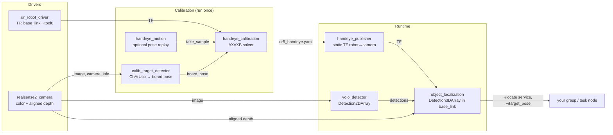

# UR5 Hand-Eye Calibration + YOLO Cup Localization (ROS 2 Humble)

A modular ROS 2 workspace that:

1. **Calibrates** where an Intel RealSense camera is relative to a UR5 arm (hand-eye calibration), and
2. **Localizes objects** (a cup by default) by running YOLO on the colour image and publishing their 3D pose in the robot's `base_link` frame.

Every stage is its own package that talks to the others only through standard ROS topics, services and TF. Any piece (the camera, the detector or the calibration method) can be swapped without touching the rest.

## Architecture



| Package | Role | Interface |
|---|---|---|
| `handeye_interfaces` | Service definitions | `TakeSample`, `ComputeCalibration`, `LocateObject` |
| `ur5_common` | Pure-numpy transform math (unit tested) | Python library |
| `calib_target_detector` | ChArUco board pose from the colour image | pub `~/board_pose` (PoseStamped), `~/debug_image` |
| `handeye_calibration` | Records samples, solves eye-in-hand **or** eye-to-hand | srv `~/take_sample`, `~/compute`, `~/remove_last`, `~/reset` |
| `handeye_motion` | (Optional) records/replays joint poses for repeatable calibration | srv `~/record_pose`, `~/run`, `~/stop`, `~/clear_poses` |
| `handeye_publisher` | Loads the YAML result and attaches `camera_link` to the robot TF tree | static TF |
| `yolo_detector` | Ultralytics YOLO → `vision_msgs/Detection2DArray` | pub `~/detections`, `~/debug_image` |
| `object_localization` | 2D box + depth + TF → 3D pose in `base_link` | pub `~/detections_3d`, `~/target_pose`, `~/markers`; srv `~/locate` |
| `ur5_bringup` | Launch files, parameters, RViz layouts | `calibration.launch.py`, `cup_detection.launch.py` |

**Why it's easy to plug in a different detector:** `object_localization` only consumes `vision_msgs/Detection2DArray`. A fine-tuned YOLO, Grounding DINO, or anything else that publishes that message works unchanged. The camera-to-robot transform lives in TF, so nothing downstream cares whether the camera is on the wrist or on a tripod.

## Setup (Ubuntu 22.04 + ROS 2 Humble)

```bash
sudo apt install ros-humble-ur ros-humble-realsense2-camera ros-humble-vision-msgs \
                 ros-humble-cv-bridge ros-humble-message-filters ros-humble-tf2-ros
cd ~/UR5-arm                      # this repo is the colcon workspace
pip install -r requirements.txt   # ultralytics, OpenCV 4.x, numpy<2
rosdep install --from-paths src --ignore-src -y
colcon build --symlink-install
source install/setup.bash
```

Two version pins in `requirements.txt` matter:

- **OpenCV < 5.** OpenCV 5.0's Python bindings no longer expose `cv2.calibrateHandEye`. The solver raises a clear error if it finds 5.x.
- **NumPy < 2.** Humble's `cv_bridge` is compiled against NumPy 1.x.

UR side: install the **External Control** URCap on the pendant, and set its host IP to this PC. See the [UR driver docs](https://docs.universal-robots.com/Universal_Robots_ROS2_Documentation/).

## Step 1: Calibrate (once, or whenever the camera moves)

1. **Print the board:** `ros2 run calib_target_detector generate_board --out board.png`. Print it at 100% scale on A4 or Letter and glue it to something flat and rigid. **Measure one square with calipers.** If it isn't exactly 35 mm, put the measured value in `ur5_bringup/config/calibration.yaml`.
2. **Mount the board:**
   - `eye_to_hand` (camera fixed in the cell, the default): attach the board rigidly to the tool flange.
   - `eye_in_hand` (camera on the wrist): fix the board to the table.
3. **Start the session** on the PC wired to the robot and camera:
   ```bash
   scripts/handeye_calibrate.sh <UR_IP>                 # eye_to_hand (default)
   scripts/handeye_calibrate.sh <UR_IP> eye_in_hand     # camera on the wrist
   ```
   It checks the robot answers (ping, dashboard port 29999), that a RealSense is plugged in, and which board size is configured. Then it starts `calibration.launch.py` in the background (log: `~/.ros/handeye/session.log`) and opens an interactive console. Check the *Board detection* image in RViz: it shows the board axes and a reprojection error in green. Extra launch arguments pass straight through, e.g. `use_motion:=true rviz:=false`.
4. **Collect 15–20 samples.** Freedrive the arm to a pose, let it stop, and press **Enter** in the console. **Vary the wrist orientation a lot**, at least ±30° about two or more different axes. Translation-only motion can't be solved. Each sample reports the rotation spread so far; samples taken while the arm is moving or the board is out of view are rejected. Freedrive sampling only needs the driver's joint states, so the External Control program doesn't have to be running.

   | Key | Action |
   |---|---|
   | Enter | take a sample |
   | `p` | take a sample and record the joint pose for replay (`use_motion:=true`) |
   | `u` / `r` | undo last sample / reset all |
   | `c` | compute and show the result |
   | `s` | compute and **save** |
   | `?` | board / robot TF status |
   | `q` | quit (stops the whole session) |
5. **Solve and save** with `s`. This writes `~/.ros/handeye/ur5_handeye.yaml` plus the raw samples. A good result has a residual of a few mm and well under 1°.

   Prefer raw ROS? `ros2 launch ur5_bringup calibration.launch.py robot_ip:=<UR_IP> mount:=eye_to_hand`, then `ros2 run handeye_calibration calibrate_cli` (or `scripts/handeye_calibrate.sh --console-only`), or call `/handeye_calibration/take_sample` and `/handeye_calibration/compute` directly.
6. **(Optional) Compare solver methods offline** on the same samples:
   ```bash
   ros2 run handeye_calibration solve_offline ~/.ros/handeye/ur5_handeye_samples.yaml
   ```

**Repeatable re-calibration:** launch with `use_motion:=true`. During the first run, press `p` instead of Enter at each pose (or call `/handeye_motion/record_pose`). Later, `/handeye_motion/run` replays those poses (in joint space, at ≤ 0.3 rad/s) and takes a sample at each one. Then call `compute`. Keep the e-stop within reach.

## Step 2: Find the cup

```bash
ros2 launch ur5_bringup cup_detection.launch.py robot_ip:=<UR_IP>
```

- RViz shows the YOLO image, a box marker on each cup in the robot frame, and the target pose.
- Streaming output: `/object_localization/target_pose` (PoseStamped in `base_link`).
- On demand:
  ```bash
  ros2 service call /object_localization/locate handeye_interfaces/srv/LocateObject \
      "{class_name: cup, timeout_s: 2.0}"
  ```

Useful launch arguments:

- `target_class:=bottle`: any COCO class.
- `model:=/path/best.pt`: a fine-tuned model.
- `device:=cuda:0`
- `launch_robot:=false launch_camera:=false`: use drivers you started yourself.

**Accuracy notes:**

- The reported point is the visible surface at the box center. Set `surface_to_centre_m` (about 0.04 for a mug) to report the cup's center instead.
- If the camera looks down into the cup's opening, lower `depth_percentile` (e.g. 30) so it favors the rim rather than the bottom.

## Tests

The math is ROS-free and unit tested. Tests cover synthetic ground truth for both mounts and all five solvers, noisy recovery, ChArUco detection on a rendered board, depth sampling and YAML round-trips. They pass on both OpenCV 4.5 (Humble's system version) and 4.14:

```bash
colcon test --packages-select ur5_common handeye_calibration calib_target_detector object_localization
colcon test-result --verbose
```

## Frames

| Frame | Published by |
|---|---|
| `base_link` → … → `tool0` | UR driver |
| `base_link` → `camera_link` (eye-to-hand)<br/>`tool0` → `camera_link` (eye-in-hand) | `handeye_publisher`. It's computed from the calibrated optical frame and the RealSense's own `camera_link` → `camera_color_optical_frame` chain, so TF never sees two parents. |
| `camera_link` → `camera_color_optical_frame` | RealSense driver |
