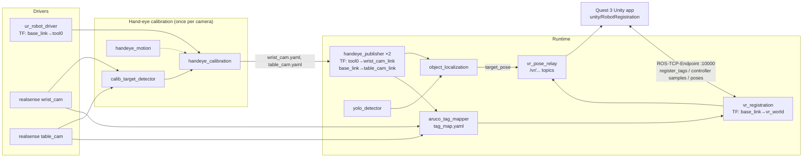

# UR5 Hand-Eye Calibration, YOLO Localization and Quest 3 Registration (ROS 2 Humble)

A modular ROS 2 workspace for a UR5 with two Intel RealSense cameras (one on the wrist, one on the table) and a Meta Quest 3. It does four things:

1. **Calibrates both cameras** to the robot (hand-eye calibration):
   - `wrist_cam`: eye-in-hand.
   - `table_cam`: eye-to-hand.
2. **Localizes objects** (a cup by default) with YOLO + depth, as 3D poses in the robot's `base_link` frame.
3. **Maps fixed ArUco tags** in the workspace with both cameras. This also cross-checks the two calibrations against each other.
4. **Registers the Quest 3's world to the robot** using those tags (or a controller clamped to the flange). A Unity game can then show the robot and the cup in the right place, in mixed reality.

Each stage is its own package. Packages talk only through ROS topics, services and TF, so any piece (camera, detector, VR client) can be swapped.

## Architecture



| Package | Role |
|---|---|
| `handeye_interfaces` | `TakeSample`, `ComputeCalibration` and `LocateObject` services |
| `vr_interfaces` | `TagObservation` message; `RegisterTags`, `AddControllerSample`, `SolveRegistration` and `GetTagMap` services |
| `ur5_common` | Pure-numpy transform math |
| `calib_target_detector` | ChArUco board pose (for hand-eye calibration) |
| `handeye_calibration` | Records samples and solves eye-in-hand or eye-to-hand (OpenCV `calibrateHandEye`) |
| `handeye_motion` | Optional: records and replays arm poses for repeatable calibration |
| `handeye_publisher` | Attaches each calibrated camera to the robot TF tree |
| `yolo_detector` | Ultralytics YOLO → `vision_msgs/Detection2DArray` |
| `object_localization` | 2D box + depth + TF → 3D pose in `base_link`, plus a `~/locate` service |
| `aruco_tag_mapper` | Fuses ArUco tag sightings from both cameras into `tag_map.yaml`, in `base_link` |
| `vr_registration` | Solves `base_link → vr_world` (from tags or a controller on the flange), and relays poses into `vr_world` |
| `ur5_bringup` | Launch files, configs and RViz layouts |
| `unity/RobotRegistration` | Quest 3 C# scripts (see [`unity/README.md`](unity/README.md)) |

## Setup (Ubuntu 22.04 + ROS 2 Humble)

```bash
sudo apt install ros-humble-ur ros-humble-realsense2-camera ros-humble-vision-msgs \
                 ros-humble-cv-bridge ros-humble-message-filters ros-humble-tf2-ros
cd ~/UR5-arm                                   # this repo is the colcon workspace
git clone -b main-ros2 https://github.com/Unity-Technologies/ROS-TCP-Endpoint.git src/ros_tcp_endpoint
pip install -r requirements.txt                # ultralytics, OpenCV 4.x, numpy<2
rosdep install --from-paths src --ignore-src -y
colcon build --symlink-install
source install/setup.bash
```

Two pins in `requirements.txt` matter:

- **OpenCV < 5.** OpenCV 5.0's Python bindings don't expose `calibrateHandEye` or `calibrateRobotWorldHandEye`.
- **NumPy < 2.** Humble's `cv_bridge` is compiled against NumPy 1.x.

On the UR pendant, install the **External Control** URCap.

**Camera serial numbers are required** because there are two RealSenses. Find them with `rs-enumerate-devices -s`, then pass `wrist_cam_serial:=... table_cam_serial:=...` to every launch file below. If both cameras share one USB controller and frames drop, lower their resolution in `cameras.launch.py`.

## Step 1: Calibrate both cameras

Print the ChArUco board (`ros2 run calib_target_detector generate_board --out board.png`) at 100% scale on A4 or Letter. Glue it to something rigid, measure a square, and set `square_length` in `config/calibration.yaml`.

Run one session per camera. The mount follows from the camera:

| Camera | Mount | Board placement |
|---|---|---|
| `wrist_cam` | eye-in-hand | Fixed on the table |
| `table_cam` | eye-to-hand | Clamped to the tool flange |

**Start a session** on the PC wired to the robot and cameras:

```bash
export WRIST_CAM_SERIAL=<SN> TABLE_CAM_SERIAL=<SN>     # from rs-enumerate-devices -s
scripts/handeye_calibrate.sh <UR_IP> wrist_cam
scripts/handeye_calibrate.sh <UR_IP> table_cam
```

The script runs preflight checks:

- the robot answers (ping, dashboard port 29999)
- both RealSense serials are plugged in
- which board size is configured

Then it starts `calibration.launch.py` in the background (log: `~/.ros/handeye/session.log`) and opens an interactive console. Check the *Board detection* image in RViz: it shows the board axes and a reprojection error in green. Extra launch arguments pass straight through, e.g. `use_motion:=true rviz:=false`.

**Collect 15–20 samples.** Freedrive the arm to a pose, let it stop, and press **Enter** in the console.

- **Vary the wrist orientation a lot**, at least ±30° about two or more different axes. Translation-only motion can't be solved.
- Each sample reports the rotation spread so far. Samples taken while the arm is moving or the board is out of view are rejected.
- Freedrive sampling only needs the driver's joint states, so the External Control program doesn't have to be running.

| Key | Action |
|---|---|
| Enter | take a sample |
| `p` | take a sample and record the joint pose for replay (`use_motion:=true`) |
| `u` / `r` | undo last sample / reset all |
| `c` | compute and show the result |
| `s` | compute and **save** |
| `?` | board / robot TF status |
| `q` | quit (stops the whole session) |

**Solve and save** with `s`. This writes `~/.ros/handeye/<camera>.yaml` plus the raw samples. A good result has a residual of a few mm and well under 1°.

**Prefer raw ROS?** Run:

```bash
ros2 launch ur5_bringup calibration.launch.py camera:=wrist_cam robot_ip:=<IP> wrist_cam_serial:=<SN> table_cam_serial:=<SN>
```

Then either:

- `ros2 run handeye_calibration calibrate_cli` (or `scripts/handeye_calibrate.sh --console-only`), or
- call `/handeye_calibration/take_sample` and `/handeye_calibration/compute` directly.

**Compare solver methods offline** with `ros2 run handeye_calibration solve_offline ~/.ros/handeye/<camera>_samples.yaml`.

**Repeatable re-calibration:** launch with `use_motion:=true`. During the first run, press `p` instead of Enter at each pose. Later, `/handeye_motion/run` replays those poses (in joint space, at ≤ 0.3 rad/s) and takes a sample at each one. Keep the e-stop within reach.

## Step 2: Find the cup

```bash
ros2 launch ur5_bringup cup_detection.launch.py robot_ip:=<IP> wrist_cam_serial:=<SN> table_cam_serial:=<SN> \
    detection_camera:=table_cam
ros2 service call /object_localization/locate handeye_interfaces/srv/LocateObject "{class_name: cup, timeout_s: 2.0}"
```

The cup's pose also streams on `/object_localization/target_pose`, in `base_link`. Other options:

- `target_class:=bottle`, or any other COCO class.
- `model:=best.pt` for a fine-tuned model.
- `surface_to_centre_m` (about 0.04 for a mug) to report the cup's centre instead of its front face.

## Step 3: Map the ArUco tags

1. **Print tags:** run `ros2 run aruco_tag_mapper generate_tags --ids 0 1 2 3 4 5 --out-dir tags/`. Each tag is 10 cm, from `DICT_4X4_50`. Measure the black square and set `marker_length` in `config/vr.yaml`.
2. **Fix them flat** around the table, spread out (not in a line), where both cameras and the headset can see them.
3. **Launch:**
   ```bash
   ros2 launch ur5_bringup vr.launch.py robot_ip:=<IP> wrist_cam_serial:=<SN> table_cam_serial:=<SN>
   ```
   Then move the arm so the wrist camera also sweeps over the tags.
4. **Save:**
   ```bash
   ros2 service call /aruco_tag_mapper/save std_srvs/srv/Trigger
   ```
   This writes `~/.ros/handeye/tag_map.yaml`. For each tag it reports which cameras saw it and **how far apart the two cameras' estimates are**. A few mm means both hand-eye calibrations agree. Centimetres means one of them is off.

## Step 4: Register the Quest 3

With `vr.launch.py` still running (it also starts the ROS-TCP-Endpoint on port 10000), register from the headset using the Unity scripts. See [`unity/README.md`](unity/README.md).

- **Tag touch:** touch 3–6 tag centres with the controller tip. Expect about 1 cm.
- **Controller on flange:** clamp the right controller to the flange and take 10–15 arm poses. Expect a few mm. This method doesn't need the tag map.

The tag method uses `mode: yaw_only` by default. It assumes `base_link` is level (robot on a level table) and solves only position plus heading. With cm-level VR noise this is much more robust than a full 6-DOF fit; a unit test checks it. Set `mode: full` if the robot is mounted tilted.

The result is published as static TF `base_link → vr_world` and saved to `~/.ros/handeye/vr_registration.yaml`. It's reloaded automatically on the next launch, as long as the Unity `RobotWorldFrame` hasn't moved. The game then subscribes to:

- `/vr/robot_base_pose`: where to place the UR5 model.
- `/joint_states`: animates the arm.
- `/vr/object_localization/target_pose`: the cup.

## Tests

The math is ROS-free and unit tested. The tests use synthetic ground truth for both hand-eye mounts and all five solvers, ChArUco and ArUco detection on rendered images, multi-camera tag fusion, point and controller-on-flange registration, and YAML round-trips. They pass on OpenCV 4.5 (Humble's system version) and 4.14:

```bash
colcon test && colcon test-result --verbose
```

## Frames

| Frame | Published by |
|---|---|
| `base_link` → … → `tool0` | UR driver |
| `tool0` → `wrist_cam_link`, `base_link` → `table_cam_link` | `handeye_publisher` (computed so the RealSense's own `*_link → *_color_optical_frame` chain stays intact) |
| `<cam>_link` → `<cam>_color_optical_frame` | RealSense drivers |
| `base_link` → `tag_<id>` | `aruco_tag_mapper` |
| `base_link` → `vr_world` | `vr_registration` (the Unity `RobotWorldFrame`, in ROS axes) |
