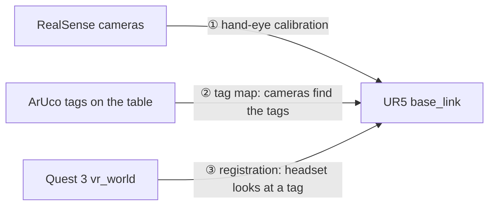

# UR5 + Meta Quest 3: Shared Coordinates for Mixed Reality (ROS 2 Humble)

This workspace connects a **UR5 robot arm**, two **Intel RealSense cameras** and a **Meta Quest 3 headset**, so they all agree on where things are in the room. With that in place you can:

- see the robot's camera detections (e.g. a cup) in the headset,
- use the headset and controllers as inputs to your robot code (in the robot's own coordinates),
- move the arm by moving a controller, and check that it moves the way your hand does.

Everything also runs in **simulation in RViz**: no robot or headset needed. That's the best place to start.

## The big idea: coordinate frames

Every device measures positions in its own coordinate system (a *frame*). The robot uses `base_link` (origin at the base of the arm). Each camera has its own frame, and the Quest has its own world frame, which we call `vr_world`. A point at (1, 0, 0) in one frame is somewhere else entirely in another.

To combine them, we find the transform (rotation + translation) from each frame to `base_link`, one link at a time:



1. **Hand-eye calibration**: where each camera is relative to the robot.
2. **Tag map**: the calibrated cameras find printed ArUco tags (square barcodes) and save their positions in `base_link`.
3. **Registration**: the headset sees one of those tags. Since we know where that tag is in both frames, we can solve for `base_link → vr_world`.

After that, ROS's transform library (TF) can convert any pose between the robot, the cameras, the tags and the headset.

## What's in the repo

Each part is its own ROS 2 package, and they only talk through topics, services and TF, so you can swap any piece.

| Package | What it does |
|---|---|
| `calib_target_detector`, `handeye_calibration`, `handeye_motion`, `handeye_publisher` | ① Calibrate each camera to the robot and publish the result to TF |
| `yolo_detector`, `object_localization` | Find objects (a cup by default) with YOLO + depth, in `base_link` |
| `aruco_tag_mapper` | ② Map ArUco tags with both cameras into `tag_map.yaml` |
| `vr_tag_detector` | ③ Finds the tags in the Quest's camera images |
| `vr_registration` | ③ Solves `base_link → vr_world` (from tags, tag touches, or a controller clamped to the arm) |
| `vr_tracking` | Streams the headset and controllers into ROS, in `base_link`. **This is what your own code uses** |
| `vr_teleop` | Hold the grip button to move the arm's target with the controller; checks the arm moves the right way |
| `vr_sim` | A fake Quest and a simulated UR5, for testing everything in RViz |
| `vr_interfaces`, `handeye_interfaces` | Custom messages and services |
| `ur5_common` | Shared transform math |
| `ur5_bringup` | Launch files, configs and RViz layouts |
| `unity/RobotRegistration` | The Quest app's C# scripts (see [`unity/README.md`](unity/README.md)) |

## Setup (Ubuntu 22.04 + ROS 2 Humble)

```bash
sudo apt install ros-humble-ur ros-humble-realsense2-camera ros-humble-vision-msgs \
                 ros-humble-cv-bridge ros-humble-message-filters ros-humble-tf2-ros
cd ~/UR5-arm                                   # this repo is the colcon workspace
git clone -b main-ros2 https://github.com/Unity-Technologies/ROS-TCP-Endpoint.git src/ros_tcp_endpoint
pip install -r requirements.txt                # ultralytics, OpenCV 4.x, numpy<2
rosdep install --from-paths src --ignore-src -y
colcon build --symlink-install
source install/setup.bash
```

Keep OpenCV below 5 and NumPy below 2 (`requirements.txt` pins both). OpenCV 5 dropped the hand-eye solvers, and Humble's `cv_bridge` needs NumPy 1.x.

## Quick start: try it in simulation

No robot, cameras or headset needed:

```bash
ros2 launch ur5_bringup vr_sim.launch.py                            # you drag the controller
ros2 launch ur5_bringup vr_sim.launch.py controller_mode:=scripted  # hands-free demo
```

What happens:

1. A fake Quest (`quest_sim`) "looks" at three virtual tags and sends camera images, just like the real headset.
2. After ~4 s it registers itself. The log prints `Auto-registration succeeded`, and in RViz the estimated frame `vr_world` lands on the ground truth `vr_world_truth`.
3. You drive the simulated arm with the controller:
   - **Drag mode:** right-click the red *right controller* box, tick **Grip (drive the arm)**, then drag the box. The arm follows. Untick Grip to let go.
   - **Scripted mode:** after 8 s the controller traces a 20 cm square with the grip held.

Numbers worth checking:

| Topic | Meaning | Typical sim value |
|---|---|---|
| `/quest_sim/registration_error_m`, `_deg` | How far the registration is from the truth | ~4 mm, ~0.05° |
| `/vr_alignment_monitor/direction_error_deg` | Angle between how your hand moved and how the arm moved | ~0.05° on straight moves (a few ° at the square's corners, where the arm lags) |

**Real headset + simulated arm:** `ros2 launch ur5_bringup vr_sim.launch.py quest:=real` lets you try the Quest app before the real robot is involved.

## Using the real system

Run these on the PC connected to the robot and cameras. You need each camera's serial number (`rs-enumerate-devices -s`), and the **External Control** URCap installed on the UR pendant.

### Step 1: Calibrate the cameras (once)

1. Print the calibration board (`ros2 run calib_target_detector generate_board --out board.png`) at 100% scale, glue it to something flat and rigid, measure one square, and set `square_length` in `config/calibration.yaml`.
2. Calibrate each camera:
   ```bash
   export WRIST_CAM_SERIAL=<SN> TABLE_CAM_SERIAL=<SN>
   scripts/handeye_calibrate.sh <UR_IP> wrist_cam    # board fixed on the table
   scripts/handeye_calibrate.sh <UR_IP> table_cam    # board clamped to the robot's flange
   ```
3. Freedrive the arm to a pose, let it stop, and press **Enter** to take a sample. Take 15–20 samples, and **rotate the wrist a lot** between them (±30° or more, about different axes). Only sliding the arm around without rotating can't be solved.
4. Press **s** to solve and save. A good result is off by a few mm and well under 1°.

Other console keys: `u` undo, `r` reset, `c` compute without saving, `?` status, `q` quit.

### Step 2 (optional): Find the cup

```bash
ros2 launch ur5_bringup cup_detection.launch.py robot_ip:=<IP> wrist_cam_serial:=<SN> table_cam_serial:=<SN>
```

The cup's pose streams on `/object_localization/target_pose` in `base_link`. Use `target_class:=bottle` (or any COCO class) to find something else.

### Step 3: Map the ArUco tags (once, or whenever tags move)

1. Print tags: `ros2 run aruco_tag_mapper generate_tags --ids 0 1 2 3 4 5 --out-dir tags/`. Measure the printed black square and set `marker_length` in `config/vr.yaml`.
2. Tape them flat around the table, spread out, where the cameras and the headset can see them.
3. Launch the robot, cameras and Quest connection:
   ```bash
   ros2 launch ur5_bringup vr.launch.py robot_ip:=<IP> wrist_cam_serial:=<SN> table_cam_serial:=<SN>
   ```
   Move the arm so the wrist camera also sweeps over the tags.
4. Save the map:
   ```bash
   ros2 service call /aruco_tag_mapper/save std_srvs/srv/Trigger
   ```
   This writes `~/.ros/handeye/tag_map.yaml`. It also reports how far apart the two cameras' estimates of each tag are. A few mm means your calibrations agree; centimetres means one is off.

### Step 4: Register the headset by looking at a tag

Keep `vr.launch.py` running. It also starts the ROS-TCP-Endpoint (port 10000) the Quest app connects to. Set up the Unity app first ([`unity/README.md`](unity/README.md)).

1. In the headset, look at a mapped tag from about 0.5–1 m away and hold your head still for ~2 s.
2. Press **A**, or call this from the PC:
   ```bash
   ros2 service call /vr_tag_detector/register vr_interfaces/srv/SolveRegistration "{save: true}"
   ```

One tag is enough; 2–4 tags spread over the table are more accurate (about 1 cm) and let the result check itself. The registration is saved and reloaded on the next launch, as long as you don't move the Unity `RobotWorldFrame`.

Other ways to register: touch the tag centres with the controller tip, or clamp a controller to the robot's flange (the most accurate). Both are explained in [`unity/README.md`](unity/README.md).

### Step 5: Use the headset and controllers in your own robot code

Once registered, `quest_bridge` publishes everything in the robot's frame using standard ROS messages:

| What | Type |
|---|---|
| TF frames `quest_head`, `quest_left_controller`, `quest_right_controller` | TF (x axis = where you look / point) |
| `/quest/head/pose`, `/quest/left_controller/pose`, `/quest/right_controller/pose` | `geometry_msgs/PoseStamped` in `base_link` |
| `/quest/left_controller/joy`, `/quest/right_controller/joy` | `sensor_msgs/Joy`: `axes = [stick x, stick y, trigger, grip]`, `buttons = [A/X, B/Y, stick press, menu]` |
| `/vr_teleop/target_pose` (with `teleop:=true`) | `geometry_msgs/PoseStamped`: where the tool should go while you hold the grip |

A pose is only published while the controller is tracked. If your own launch already starts the UR driver, add `launch_robot:=false` to `vr.launch.py`.

A minimal node that prints the right controller's position:

```python
import rclpy
from rclpy.node import Node
from rclpy.time import Time
from tf2_ros import Buffer, TransformException, TransformListener

rclpy.init()
node = Node('controller_reader')
tf_buffer = Buffer()
tf_listener = TransformListener(tf_buffer, node)

def tick():
    try:
        tf = tf_buffer.lookup_transform('base_link', 'quest_right_controller', Time())
    except TransformException:
        return                          # not registered yet, or never tracked
    p = tf.transform.translation
    node.get_logger().info(f'right controller at ({p.x:.3f}, {p.y:.3f}, {p.z:.3f}) m')

node.create_timer(0.1, tick)
rclpy.spin(node)
```

> **Safety:** nothing in this repo moves the real robot. `/vr_teleop/target_pose` is only a target. Your controller (or MoveIt Servo) must limit speed, because the target can jump.

### Step 6: Check the arm moves in the controller's direction

This tests your registration on the real robot without commanding it:

```bash
ros2 run vr_teleop alignment_monitor --ros-args -p engaged_topic:="''"
```

1. Hold the right controller firmly against the robot's flange.
2. Put the arm in freedrive and push it in straight 10–20 cm lines (forward, sideways, up) without twisting the wrist.
3. Each line prints one angle on `/vr_alignment_monitor/direction_error_deg`. A few degrees or less is good. If it's larger, re-register with more tags.

## Tips and troubleshooting

- **All parameters** live in `src/ur5_bringup/config/*.yaml`. Write decimals as `1.0`, not `1`: ROS 2 rejects an integer for a decimal parameter.
- **Registration looks off?** Use more tags, spread them out, and hold your head still. The register reply lists each tag's *spread*. Over ~10 mm means the head moved, or the camera settings in the Unity app need checking (see the checklist in [`unity/README.md`](unity/README.md)).
- **No controller poses?** Check the Quest app is connected (`ros2 topic hz /quest/state`) and that registration succeeded (`ros2 run tf2_ros tf2_echo base_link vr_world`).
- **Saved files** are in `~/.ros/handeye/` (calibrations, tag map, registration). The simulation uses `~/.ros/vr_sim/` and never touches the real files.

## Tests

The math is ROS-free and unit tested against synthetic ground truth (calibration solvers, tag detection, registration, robot kinematics, teleop):

```bash
colcon test && colcon test-result --verbose
```

## Frames reference

| Frame | Published by |
|---|---|
| `base_link` → … → `tool0` | UR driver (in simulation: `robot_state_publisher` + `ur5_kinematic_sim`) |
| `tool0` → `wrist_cam_link`, `base_link` → `table_cam_link` | `handeye_publisher` |
| `base_link` → `tag_<id>` | `aruco_tag_mapper` |
| `base_link` → `vr_world` | `vr_registration` (`vr_world` is the Unity `RobotWorldFrame`) |
| `vr_world` → `quest_head`, `quest_left_controller`, `quest_right_controller` | `quest_bridge` |
| `base_link` → `vr_world_truth` → `quest_*_truth` | `quest_sim` (simulation only: the ground truth) |

Want more depth? Every node's file starts with a docstring that explains its parameters and topics, and [`unity/README.md`](unity/README.md) covers the Quest side in detail.
