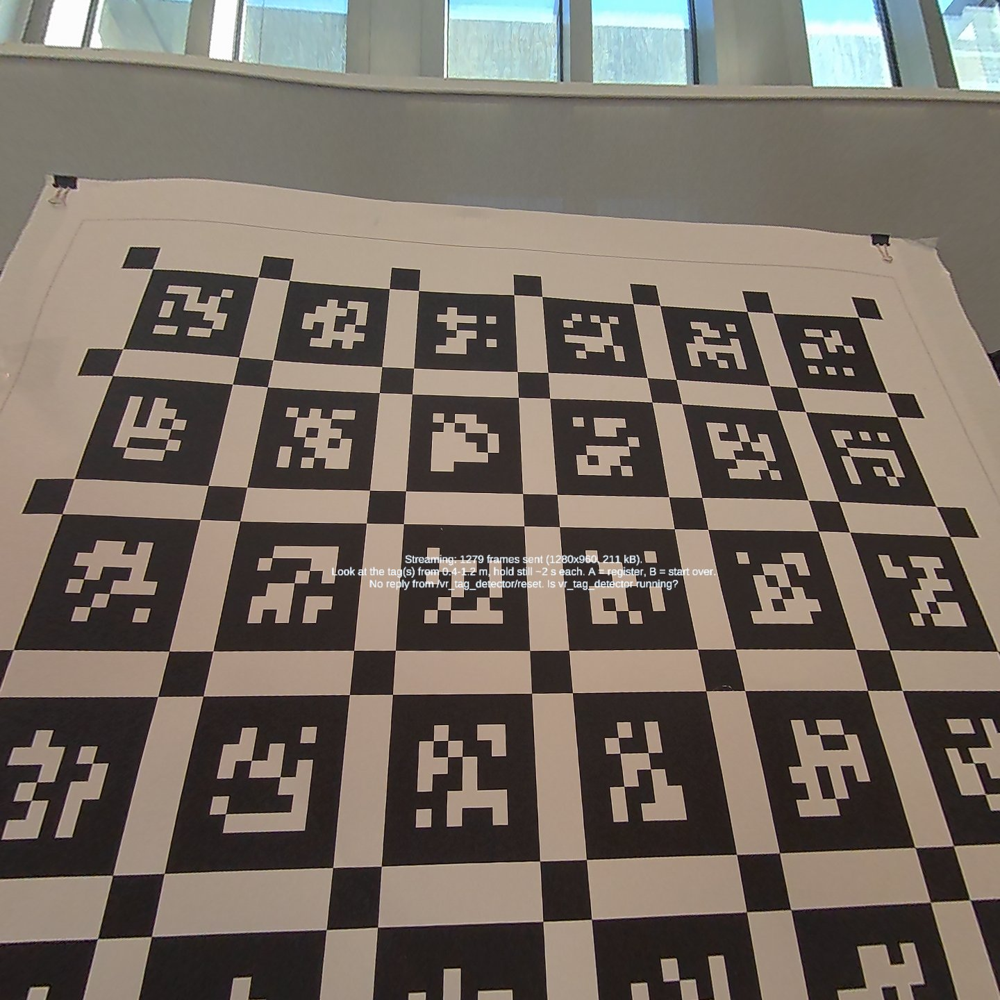
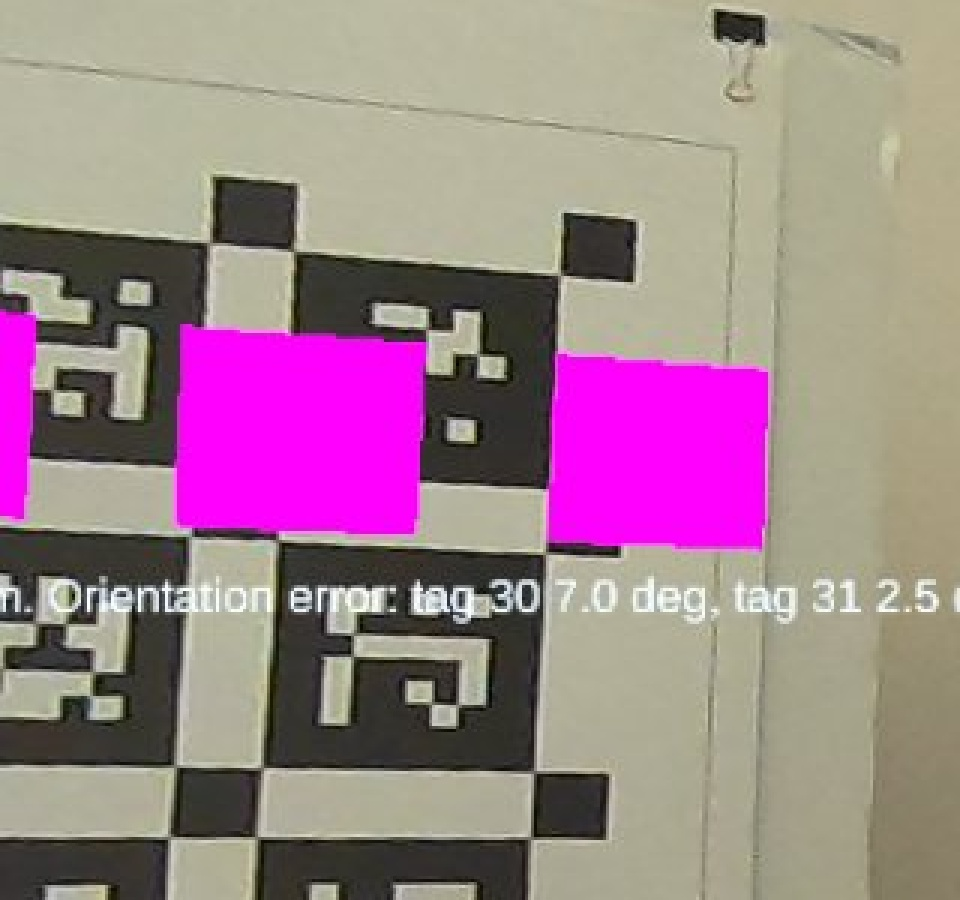
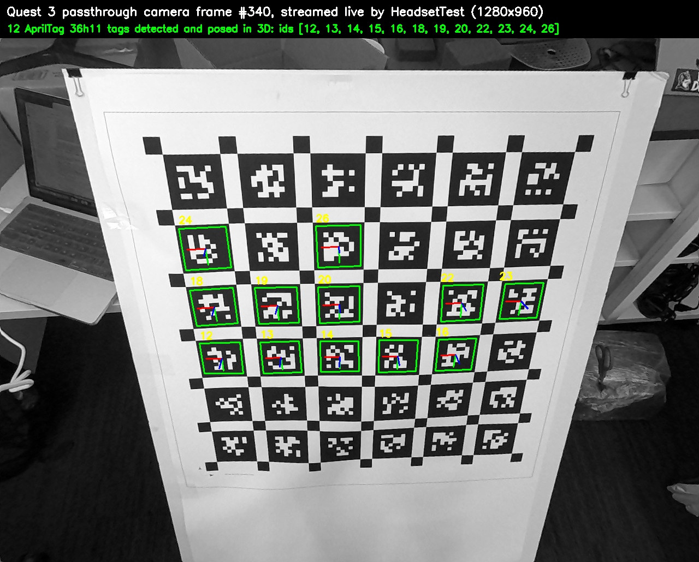
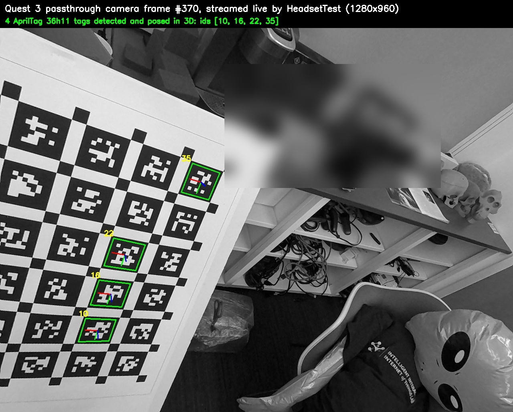
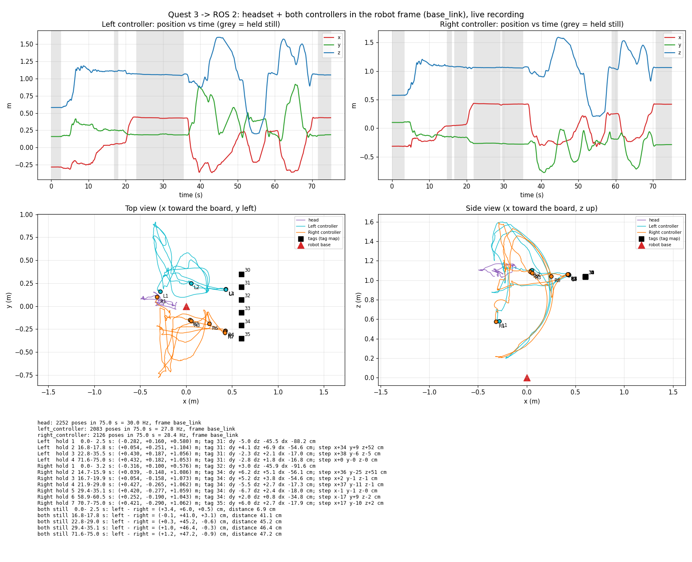

# Headset Test Results: Quest 3 (November 2026)

The first run of this repo on a real headset: a Meta Quest 3 (Horizon OS v207) running the bare test app from [the headset test](../headset-test.md).
- **ROS side:** in [Docker](../../docker/README.md) on a Mac, connected over USB.
- **Robot:** the **simulated** UR5. Its base was placed by a hand-written tag map: a pretend robot on the floor, 0.6 m in front of a lab board of AprilTag 36h11 tags (8.9 cm).

The real UR5 hasn't been used yet.

**Versions:** Unity 6000.0.85f1, Meta XR Core SDK + MRUK 207.0.1, OpenXR Plugin 1.18.0, ROS-TCP-Connector v0.7.0, ROS 2 Humble.

## Summary

| Check | Result |
|---|---|
| App runs, passthrough on, headset camera on (1280×960) | ✅ |
| Camera intrinsics | ✅ fx = fy = 866.1 px, principal point 2.0 / −4.5 px from the image centre |
| Camera images upright, tags detected and posed in 3D | ✅ up to 12 tags per frame |
| A tag stays put while the head turns | ✅ 4.4 mm spread over a 26° head turn (pass ≤ 10 mm) |
| Calibration from 6 tags (one row) | ✅ RMS 4.8 mm, max 7.1 mm |
| Squares drawn on the printed tags | ⚠️ about 80% overlap, i.e. roughly 1–2 cm off (see [Accuracy](#accuracy)) |
| Head and both controllers published in `base_link` | ✅ 30 Hz head, 28 Hz controllers |
| Another ROS 2 package uses the coordinates | ✅ [`quest_listener_example`](../../src/quest_listener_example) |

## 1. Inside the headset

What the wearer sees: color passthrough with the app's status line. The "No reply" message is expected here, because this run used a stand-in for ROS that receives frames but doesn't answer services.



After calibrating, the app draws a square on each mapped tag. Here they're magenta, because this build gave them no material, and Unity draws a missing shader in magenta. A later build used a see-through green material, and the [Unity developer guide](../../unity/README.md#2-add-these-objects-to-your-scene) now says to assign one. The squares sit on the top row of the board:



Full screenshots: [calibrated_squares.jpg](calibrated_squares.jpg), [calibrated_view.jpg](calibrated_view.jpg).

## 2. What the headset camera sees

Frames streamed by the app. The outlines and 3D axes (red x, green y, blue z) come from the repo's own tag detector:





## 3. Headset and controllers in robot coordinates

`base_link`: x toward the board, y left, z up, origin at the (pretend) robot base. In a 75 s recording ([CSV](both_controllers.csv)) both controllers were moved together, then held on two tags of the top row:



- **Left stays left:** whenever both were held still, the left controller was 41–47 cm to the left of the right one.
- **They move as the hands did:** raising both gave z +52 / +51 cm, and pushing both toward the board gave x +38 / +37 cm.
- **They land on the tags:** the height matched the touched tags within 2.1 / 2.7 cm, and the sideways position within 2.3 / 5.5 cm.
- **The 17 cm gap to the board is the controller itself:** both controllers stopped 17 cm short in x. Their tracking point is inside the handle, not at the part touching the board.

An earlier single-controller recording: [pose_recording.png](pose_recording.png) ([CSV](pose_recording.csv)).

## 4. Another package receives them

[`quest_listener_example`](../../src/quest_listener_example) is written the way a teammate's robot code would be. It uses only standard ROS messages, and logs once a second ([full log](listener_output.txt)):

```
head: 30 Hz at (-0.591, -0.574, +0.767) m | left_controller: 30 Hz at (-0.256, -0.481, +0.732) m | right_controller: 30 Hz at (-0.352, -0.535, +0.728) m | right controller -> tool0: 1.120 m (TF)
```

The distance to `tool0` (the robot's tool flange) comes from TF. That shows the Quest poses and the robot's own frames are one coordinate system. ROS's wiring report ([ros_graph.txt](ros_graph.txt)) shows `quest_bridge` publishing and `quest_listener_example` subscribing. The TF tree ([PDF](tf_tree.pdf)) shows both systems in one tree:


## Accuracy

The calibration numbers are good: 4.8 mm RMS, and 4.4 mm spread while the head turns. The squares still look 1–2 cm off. Where that comes from:
- **The tag map:** the tag spacing (14.0 cm) and row height were measured by the headset, not a ruler. The board leans back about 3° but was mapped as vertical.
- **Passthrough:** the headset rebuilds the room from cameras a few cm from your eyes, so real objects can look about 1 cm off from virtual ones.

To improve:
- Measure the tag spacing with a ruler.
- Map two rows, and include the lean.
- Collect sightings from 0.5–0.7 m at three spots (press B first).
- On the real robot, the [controller-on-flange method](../../unity/README.md#other-ways-to-register) gives a few mm.

**Not tested yet:** the real UR5 (tags measured from its base, then README Step 4: the arm moves in the controller's direction).
